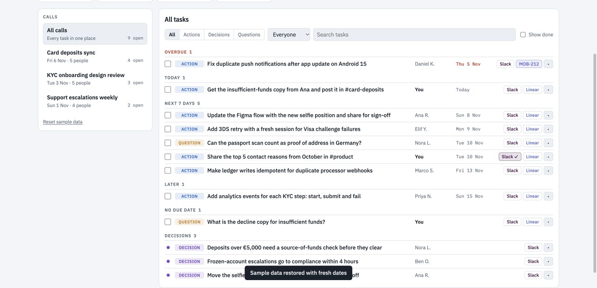

# Call Task Hub

Turn a meeting transcript into actions, decisions and open questions. Review owners and dates, then prepare a follow-up.



**Status: working local demo.** Slack and Linear buttons simulate a handoff. Claude features require a compatible artifact host.

## Try it

1. Download this repository and open `index.html` in your browser.
2. Select **Add transcript**. Enter speaker names, the meeting date and your name.
3. Extract the items. Review and edit each result.
4. Open a Slack or Linear draft and copy the text.

The starting calls and tasks are fictional. Changes are saved in this browser.

## Optional connected features

A compatible Claude artifact host can enable **Extract with Claude** through its `sample` capability. The [companion instructions](skills/call-task-hub/SKILL.md) explain how an assistant can draft real Slack posts or Linear issues using your connected accounts. Review the exact text and destination before approving a handoff.

## Limitations and testing

- Local extraction uses a small set of English phrases. Review implied actions, owners and dates carefully.
- Slack and Linear buttons update the demo state. Real handoffs use the companion instructions and connected tools.
- Saved data stays in one browser. Keep a separate copy of important transcripts and results.
- Local extraction tests pass. Claude extraction, acceptance-criteria drafting and real Slack/Linear handoffs await testing.
- Broader browser and mobile checks remain planned.

See [testing details](docs/validation.md) and the [example transcript](examples/call-task-hub.json).

## Run the tests

With Node.js 20 or newer, run:

```sh
node --test tests/app.test.cjs
```

## About this copy

This app comes from PM Toolkit. See [origin and license](ORIGIN.md). Google Fonts loads when internet access is available; system fonts provide a fallback.
